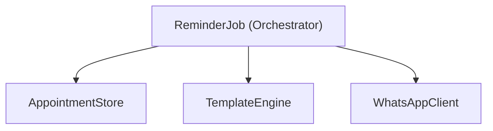

## Contoh Jawaban Referensi

### 1. Diagram Dependensi (Mermaid)

### 2. Analisis Struktur
- **Orkestrator Utama**: `ReminderJob` bertindak sebagai koordinator alur proses. Ia tahu *kapan* harus mengambil data, *kapan* membuat teks, dan *kapan* mengirimnya.
- **Komponen Daun (Leaf Nodes)**:
  - `AppointmentStore`, `TemplateEngine`, dan `WhatsAppClient` sama sekali tidak saling mengenal satu sama lain.
  - Ketiganya tidak memiliki dependensi horizontal antar sesama modul daun.

### 3. Dampak Perubahan (*Blast Radius*)
Jika template teks di `TemplateEngine` diubah (misalnya menambahkan pesan promosi klinik):
- **Komponen yang SAMA SEKALI TIDAK terpengaruh**:
  - `AppointmentStore` (tetap mengambil data janji seperti biasa).
  - `WhatsAppClient` (tetap hanya menerima string teks akhir untuk dikirim ke API).
- Isolasi ini membuktikan bahwa rancangan kita memiliki kopling yang sangat rendah (*loose coupling*).