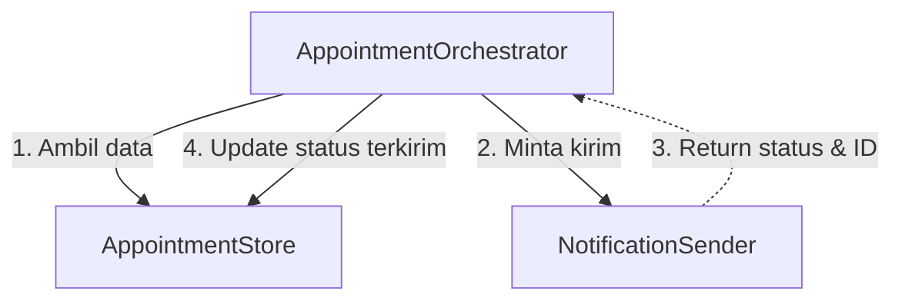

## Contoh Jawaban Referensi

### 1. Bahaya Ketergantungan Sirkular
- **Kompilasi Gagal**: Kompilator Go akan memunculkan error fatal: `import cycle not allowed: package appointment imports package notification, package notification imports package appointment`.
- **Kopling Erat (Tight Coupling)**: Modul notifikasi kehilangan independensinya; modul ini tidak bisa lagi dipakai ulang di proyek lain (misal untuk notifikasi invoice) karena terikat mati ke `AppointmentManager`.

### 2. Solusi Pemutusan Siklus (Orchestrator Pattern)
Lepaskan ketergantungan `NotificationSender` terhadap `AppointmentManager`.
- `NotificationSender.Send()` cukup bertindak sebagai fungsi murni: menerima pesan, mengirimkannya, lalu mengembalikan status pengiriman berupa `(DeliveryReceipt, error)`.
- Pemanggil (`AppointmentOrchestrator`) yang menerima kembalian tersebut bertanggung jawab mencatat pembaruan status ke penyimpanan.

### 3. Diagram Bebas Siklus (Mermaid)

Dengan pola ini, `Sender` tidak tahu apa itu `AppointmentStore`, dan aliran dependensi murni satu arah (*Acyclic Graph*).