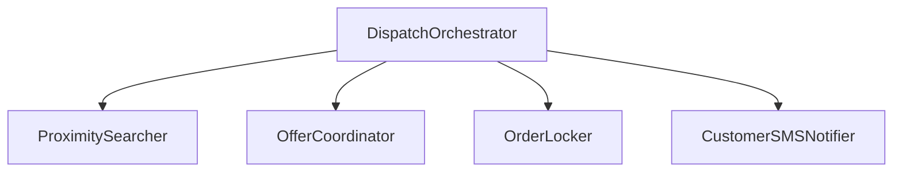

## Contoh Jawaban Referensi

### 1. Daftar Komponen Mandiri
1. **`ProximitySearcher`**: Mencari daftar ID kurir aktif yang berada dalam radius jarak tertentu dari koordinat penjemputan.
2. **`OfferCoordinator`**: Mengelola siklus penawaran order ke satu kurir dengan batas waktu tunggu 30 detik.
3. **`OrderLocker`**: Mengunci kepemilikan order ke kurir yang berhasil menerima pesanan secara atomik.
4. **`CustomerSMSNotifier`**: Mengirimkan SMS berisi tautan live tracking ke nomor telepon pelanggan.

### 2. Kontrak Komponen
#### `ProximitySearcher`
- **Input**: `PickupLocation{Lat, Lng float64}`, `RadiusKm float64`.
- **Output**: `[]CourierID` (terurut dari yang terdekat), `error`.
- **Secret**: Formula penghitungan jarak (Haversine formula atau ekstensi PostGIS).

#### `OfferCoordinator`
- **Input**: `OrderID string`, `CandidateCouriers []CourierID`, `Timeout time.Duration`.
- **Output**: `AcceptedCourierID string`, `Status` (Assigned / Exhausted), `error`.
- **Secret**: Pengelolaan timer countdown 30 detik dan mekanisme fallback ke kandidat kurir berikutnya.

### 3. Diagram Dependensi (Mermaid)

### 4. Urutan Pengerjaan
1. **Model & Geolocation Helper**: Definisi struct data (`Order`, `Location`, `Courier`) dan fungsi hitung jarak koordinat.
2. **ProximitySearcher**: Pengambilan kurir aktif terdekat berdasarkan koordinat statis.
3. **OfferCoordinator Timer**: Pengujian unit state timeout 30 detik secara deterministik.
4. **OrderLocker**: Proteksi concurrency agar satu order tidak diambil oleh dua kurir bersamaan.
5. **CustomerSMSNotifier & DispatchOrchestrator**: Penggabungan alur penuh dan integrasi SMS.